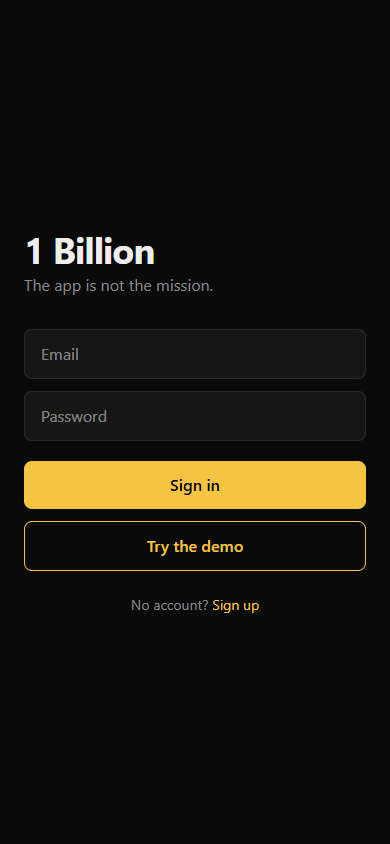
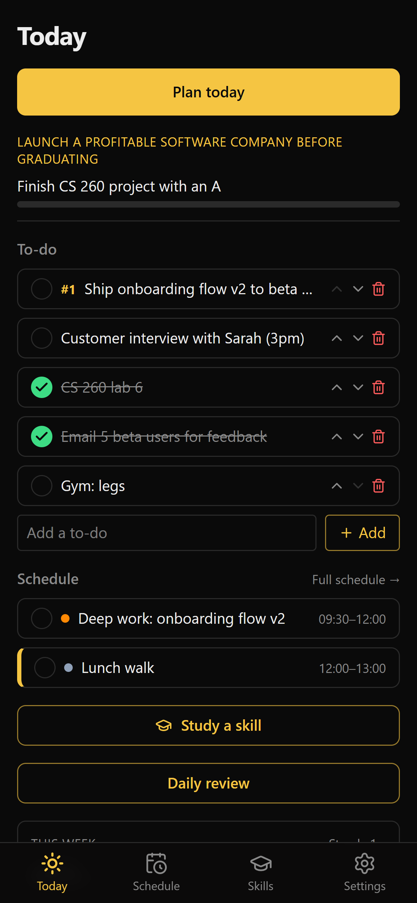
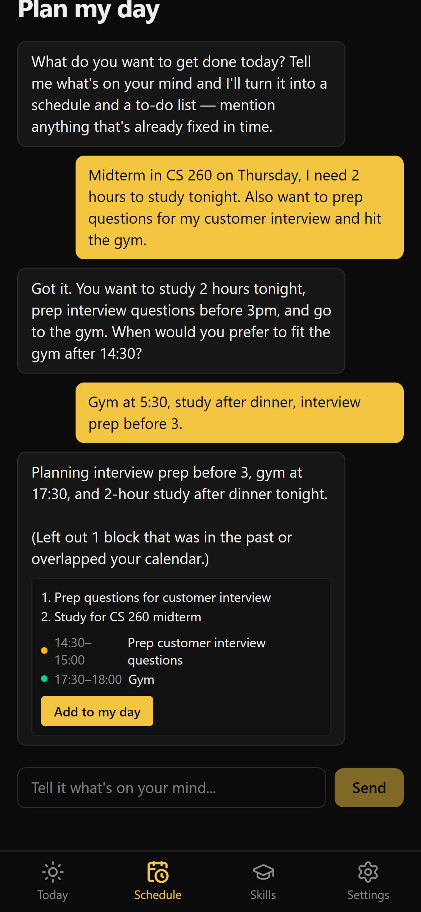
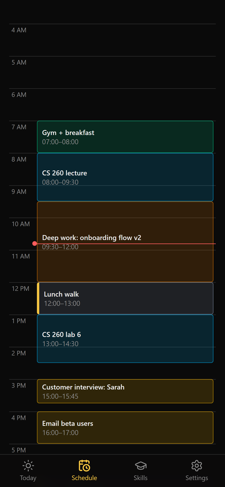
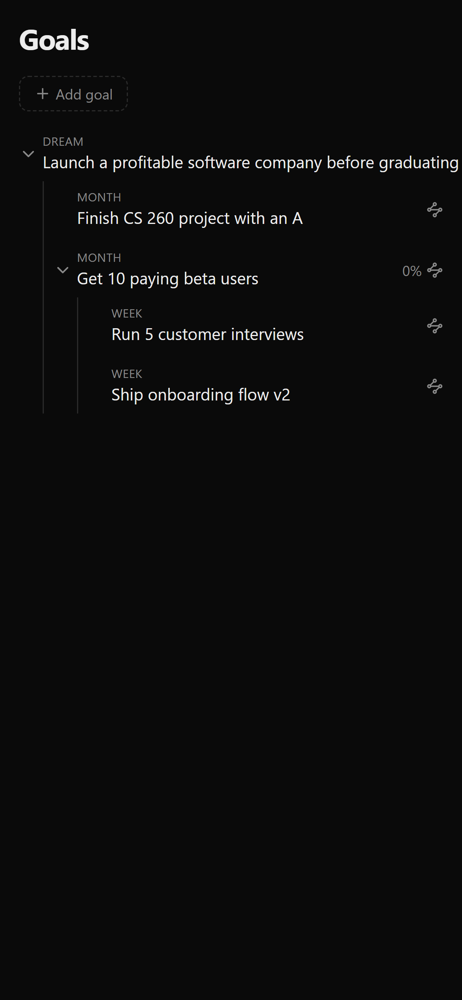
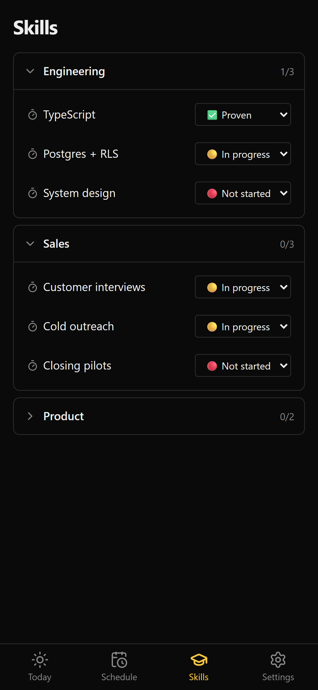
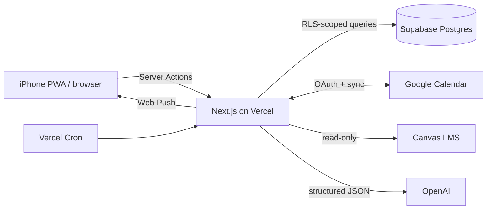

# 1 Billion — a personal operating system for getting things done

A mobile-first productivity app (installable iPhone PWA) that turns long-term goals into a daily plan: an AI planning chat builds today's to-do list and schedule, syncs it two-way with Google Calendar, pulls deadlines from Canvas, and scores every week.

**[Live demo → 1billion.vercel.app/login](https://1billion.vercel.app/login)**: tap **Try the demo** for your own private sandbox, pre-filled with sample data. No sign-up needed.

Best viewed on a phone (or DevTools at iPhone size).

<p align="center">
  
</p>

## Why I built it

I wanted one place that connects the big goal to what I do at 9am today. Off-the-shelf tools split goals, calendar, to-dos and school deadlines across four apps. I built this for myself and use it every day on my phone.

## Features

| Today | AI planner | Schedule | Goals | Skills |
|:-:|:-:|:-:|:-:|:-:|
|  |  |  |  |  |

- **AI daily planning chat:** describe your day in plain language; the assistant asks short follow-ups, then proposes an ordered to-do list and time blocks. Nothing is written until you confirm, and every change can be undone.
- **Day schedule:** a Google-Calendar-style day view with drag-to-reschedule, editable blocks, and recurring events.
- **Two-way Google Calendar sync:** OAuth connection; blocks push to your primary calendar and external events pull back in.
- **Canvas LMS import:** read-only import of course assignments; AI estimates effort, and a deterministic scheduler packs work into free time before due dates.
- **Goal chain:** dream → monthly → weekly goals, linked so every week rolls up to the big one.
- **Weekly scorecard and review:** to-dos done ÷ created, a per-day breakdown, a streak, and a review gate at the end of the week.
- **Skills and focus timer:** skill categories with a built-in focus session timer.
- **Push notifications:** Web Push to the installed iPhone app, triggered by a scheduled cron job.

## Tech stack

| Layer | Tech |
|---|---|
| Frontend | Next.js 16 (App Router, Server Components, Server Actions), React 19, TypeScript, Tailwind CSS v4 |
| Backend / DB | Supabase: Postgres, Auth, Row-Level Security; 13 versioned SQL migrations |
| Integrations | Google Calendar API (OAuth 2.0), Canvas LMS REST API, OpenAI (structured outputs validated with Zod), Web Push (VAPID) |
| Infra | Vercel (hosting + Cron), PWA (manifest + service worker) |
| Testing | Node test runner; Postgres logic tested in-process with PGlite |



## Engineering highlights

- **Two-way calendar sync without duplicates.** Each local block maps to a Google event ID through a unique index, so pushes are idempotent upserts, and edit conflicts resolve by last-modified-wins. I tracked down a Postgres `42P10` error (an `ON CONFLICT` target with no matching unique index) and fixed it in a dedicated migration.
- **Data isolation by default.** Every table has Row-Level Security policies keyed on `auth.uid()`. Only the cron job uses the service-role key, and it runs on the server only.
- **Self-cleaning demo sandboxes.** "Try the demo" signs each visitor in as a Supabase anonymous user. A Postgres function seeds sample data dated relative to today, refuses to run for non-anonymous accounts, and is covered by a PGlite test. The hourly cron deletes sandboxes after 24 hours, and their data cascade-deletes with them.
- **Secrets encrypted at rest.** Canvas access tokens are stored with AES-256-GCM, and the user ID is bound as authenticated data so a token can't be swapped between accounts ([`lib/canvas-secret.ts`](lib/canvas-secret.ts)).
- **AI output is validated rather than trusted.** The planner's responses are parsed against a Zod schema. Proposed blocks are confirmed through a Postgres function that rejects the draft if the calendar changed underneath it, so the AI can't silently double-book you.
- **AI estimates, code schedules.** For Canvas work the model only estimates effort. A deterministic, unit-tested packer ([`lib/planner.ts`](lib/planner.ts)) fits sessions around existing commitments.
- **Time zones done carefully.** All date logic lives in pure, tested functions ([`lib/dates.ts`](lib/dates.ts)) using `date-fns-tz`.

## Run locally

Requires Node 20+ and a Supabase project.

```bash
npm install
cp .env.example .env.local      # fill in at least the Supabase URL + anon key
npx supabase db push            # apply supabase/migrations
npm run dev                     # http://localhost:3000
```

Google, OpenAI, Canvas and push features each switch on when their env vars are set (see [`.env.example`](.env.example)).

## Checks

```bash
npm test             # unit tests (lib/*.test.ts)
npm run typecheck
npm run lint
npm run build
```

## Install on iPhone

Open the site in Safari, tap Share, then Add to Home Screen. Launch it from the icon; iOS only allows push notifications for installed web apps.

---

Built by [Brayden Pickard](https://www.linkedin.com/in/brayden-pickard-1b67b4390/)
